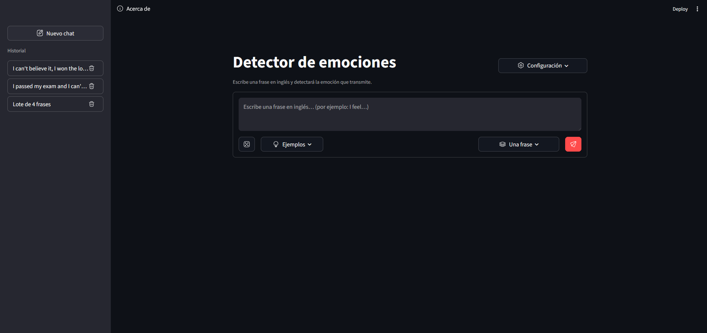
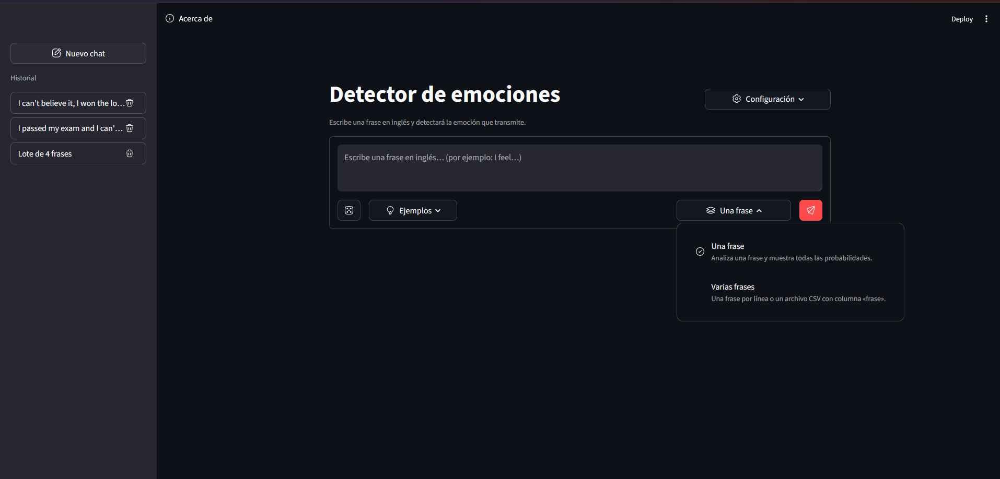
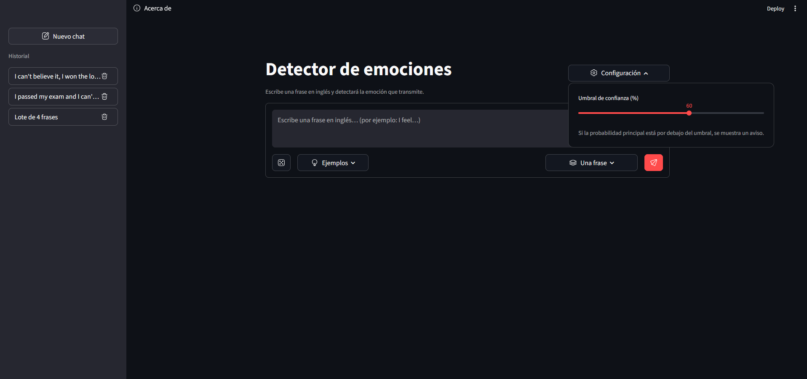
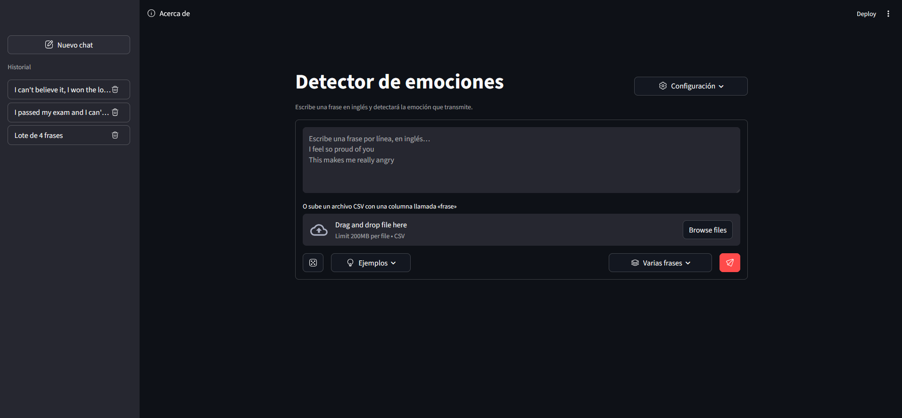
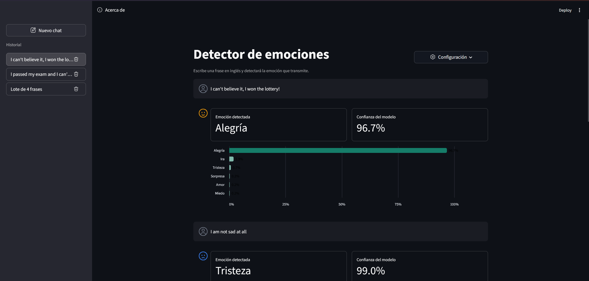
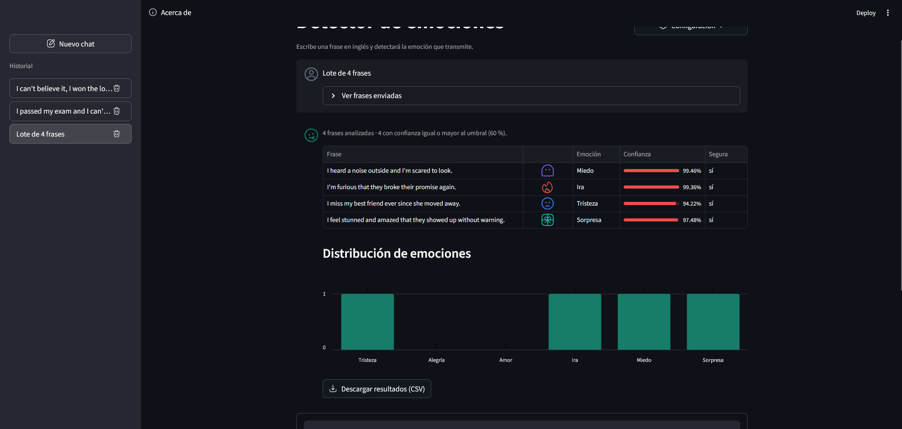

# Detector de emociones

Aplicación en Streamlit que analiza una frase en inglés. Las clases son tristeza, alegría, amor, ira, miedo y sorpresa. La interfaz muestra la emoción principal, su probabilidad y un gráfico con la distribución completa.

## Instalación y ejecución

Ejecuta estos comandos desde la raíz del proyecto en Windows PowerShell con Python 3.11.

```powershell
py -3.11 -m venv .venv
.\.venv\Scripts\python.exe -m pip install -r requirements-entrenamiento.txt
.\.venv\Scripts\python.exe -m detector.datos
.\.venv\Scripts\python.exe -m detector.entrenamiento
.\.venv\Scripts\python.exe -m detector.evaluacion
.\.venv\Scripts\python.exe -m streamlit run app.py
```

La primera corrida descarga el corpus y los pesos base desde Hugging Face. El entrenamiento genera `modelo_emociones_distilbert/` con los pesos ajustados, la configuración y el tokenizador. La carpeta se excluye de Git. Si ya tienes esa carpeta, instala `requirements.txt` y ejecuta directamente el último comando. La aplicación hace la inferencia en CPU.

## Funcionalidades

- Campo para una frase en inglés y botón **Analizar**. Las etiquetas del resultado se muestran en español.
- Emoción principal, confianza y gráfico con las seis probabilidades ordenadas.
- Avisos para una entrada vacía o un modelo que falta. El tokenizador trunca las entradas a 64 tokens.
- **Frases de ejemplo** que rellenan el campo de texto.
- **Umbral de confianza** ajustable. Si la probabilidad de la emoción principal queda por debajo del umbral, aparece un aviso.

## Capturas













## Código

| Archivo | Función |
| --- | --- |
| `app.py` | Interfaz, caché, validaciones y visualización. |
| `detector/configuracion.py` | Etiquetas, revisiones de las fuentes y parámetros compartidos. |
| `detector/datos.py` | Carga y validación del corpus, control de frases repetidas entre particiones y tokenización. |
| `detector/entrenamiento.py` | Ajuste fino y exportación del mejor checkpoint según F1 macro de validación. |
| `detector/evaluacion.py` | Comparación con TF-IDF y regresión logística, métricas, matriz de confusión y errores. |
| `detector/inferencia.py` | Carga local y cálculo de las seis probabilidades. |

## Entrenamiento y evaluación

Se ajustó DistilBERT con el subconjunto `split` de `dair-ai/emotion`. Para evitar que una frase idéntica aparezca en dos particiones, se conservó intacto el conjunto de prueba, se retiraron 3 frases de validación y 16 de entrenamiento. El ajuste utilizó **15 984** frases, la selección del checkpoint **1 997** y la evaluación final **2 000**. Se entrenaron dos épocas, con semilla 42, tasa de aprendizaje de `2e-5` y lotes de 16.

Se eligió la segunda época por su F1 macro de validación (**0,9083**). La comparación empleó las mismas frases de entrenamiento y prueba para los dos modelos. F1 macro da el mismo peso a cada emoción.

| Modelo | Exactitud en prueba | F1 macro en prueba |
| --- | ---: | ---: |
| DistilBERT ajustado | 92,95 % | 0,8883 |
| TF-IDF + regresión logística | 85,65 % | 0,8218 |

## Análisis de errores

La confusión más frecuente fue **alegría → amor** (30 casos). **Sorpresa** tuvo el F1 más bajo (0,7424). El modelo detectó 49 de sus 66 ejemplos y clasificó 14 como miedo.

| Frase de prueba | Etiqueta del corpus | Predicción | Confianza |
| --- | --- | --- | ---: |
| `i feel betrayed and angry and sad at the same time dammit` | Ira | Tristeza | 93,1 % |
| `ive blogged and i feel strange about it` | Sorpresa | Miedo | 86,4 % |

En el primer caso conviven dos emociones explícitas, `angry` y `sad`. Una sola etiqueta obliga a elegir entre señales que el texto presenta juntas. En el segundo caso, `strange` puede sugerir que algo fue inesperado o que provocó incomodidad. Sin más contexto, ambas lecturas son plausibles. Las dos predicciones equivocadas recibieron una probabilidad alta.

## Referencias

- [DistilBERT base](https://huggingface.co/distilbert/distilbert-base-uncased).
- [Corpus de emociones DAIR.AI](https://huggingface.co/datasets/dair-ai/emotion).
- Material de clase sobre ajuste fino de DistilBERT y clasificación de estilo.
- Iconos de la interfaz (`iconos/`): [Solar Icon Set](https://icon-sets.iconify.design/solar/) de 480 Design, bajo licencia [CC BY 4.0](https://creativecommons.org/licenses/by/4.0/).

## Declaración de uso de inteligencia artificial

En el proyecto se usaron dos herramientas de IA como asistentes de programación:

- **GPT Sol 6.1** (OpenAI) se utilizó para montar el backend de la aplicación: el paquete `detector/` con la carga y validación del corpus, el entrenamiento, la evaluación y la inferencia.
- **Claude Sonnet 5.5** (Anthropic), a través de Claude Code, se utilizó para:
  - Añadir la confirmación del dispositivo (CPU o GPU) antes de iniciar el entrenamiento en `detector/entrenamiento.py`.
  - Rediseñar la interfaz de `app.py`: chat con burbujas, ventana «Acerca de», configuración en una ventana flotante, selector de modo, historial de chats en la barra lateral, análisis por lotes con carga de CSV, iconos de [Solar Icon Set](https://icon-sets.iconify.design/solar/) y avatares por emoción.
  - Mejorar el diseño del README.md

El entrenamiento del modelo, la evaluación y las pruebas de la aplicación las ejecutó el equipo de forma manual, corrigiendo y probando el resultado en cada paso. El modelo que clasifica las emociones es DistilBERT ajustado por el equipo con el corpus `dair-ai/emotion`.
